# Dialogue Pratice — Qt6 客户端

局域网英语对话练习 App 的桌面客户端。Qt 6.2 + C++17，Telegram 风格的浅色界面。
本地语音输入（whisper.cpp）+ 云端翻译（OpenAI 兼容，配置在 `config/llm.json`）。
与服务端（`../Dialogue_Pratice`）共用同一份协议层，不重复实现编解码。

- 运行环境：Ubuntu 22.04 / Qt 6.2.4 / g++ 11.4（Windows + Qt 6.2+ 亦可编译）
- 部署路径：`/home/jatin/Code/Dialogue_Pratice_Client`
- 默认连接：`192.168.80.128:9000`

---

## 1. 界面预览

| 登录 | 主页（个人信息 + 进房） |
| --- | --- |
| 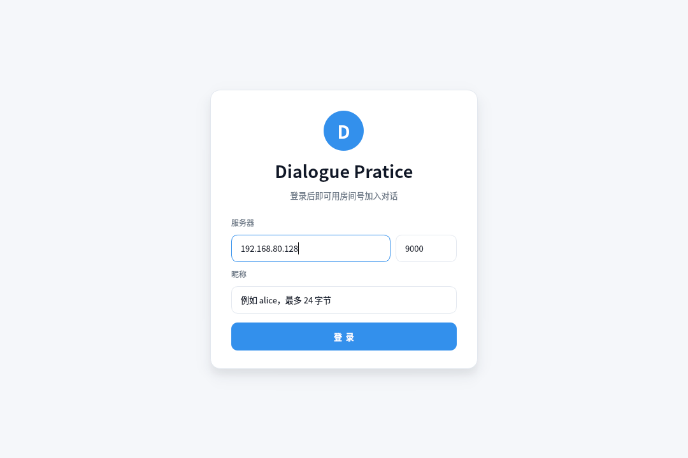 | 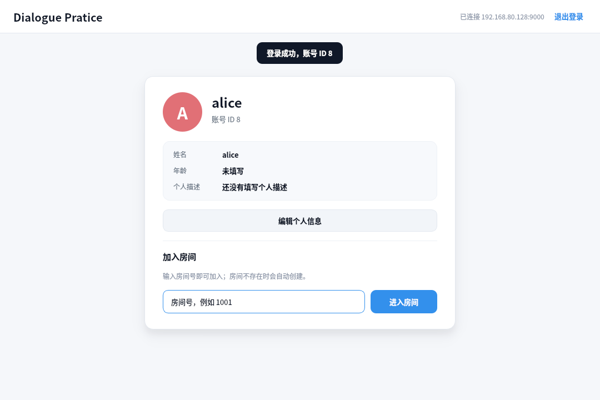 |

| 编辑个人信息 | 聊天（Telegram 风格） | 成员侧栏 |
| --- | --- | --- |
| 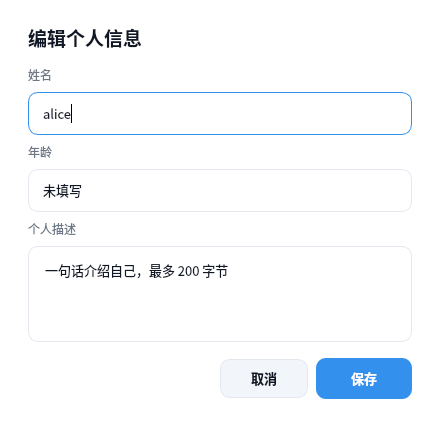 | 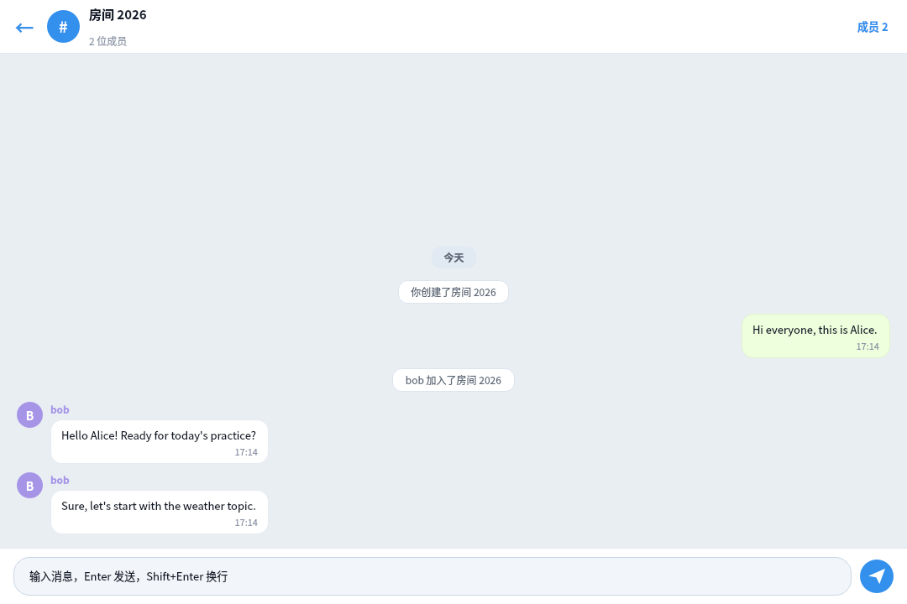 | 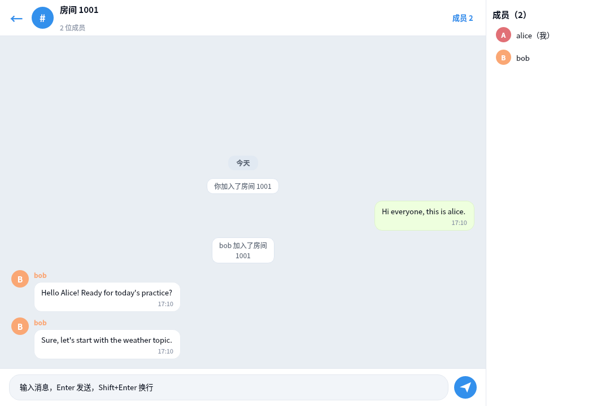 |

| 重新进房补回历史 | 断线中（输入禁用） | 重连成功 |
| --- | --- | --- |
| 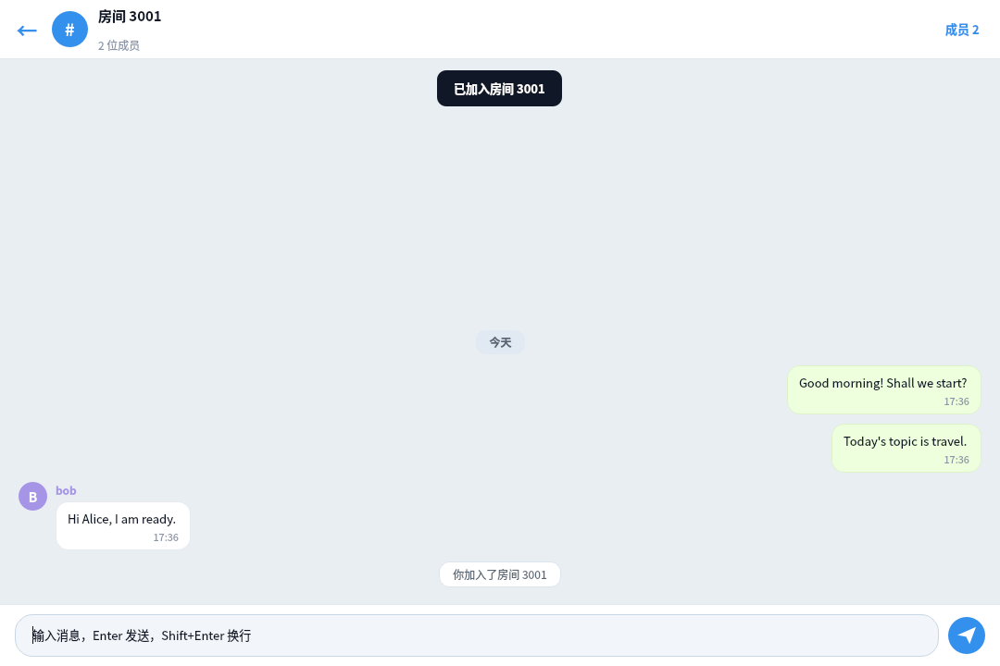 | 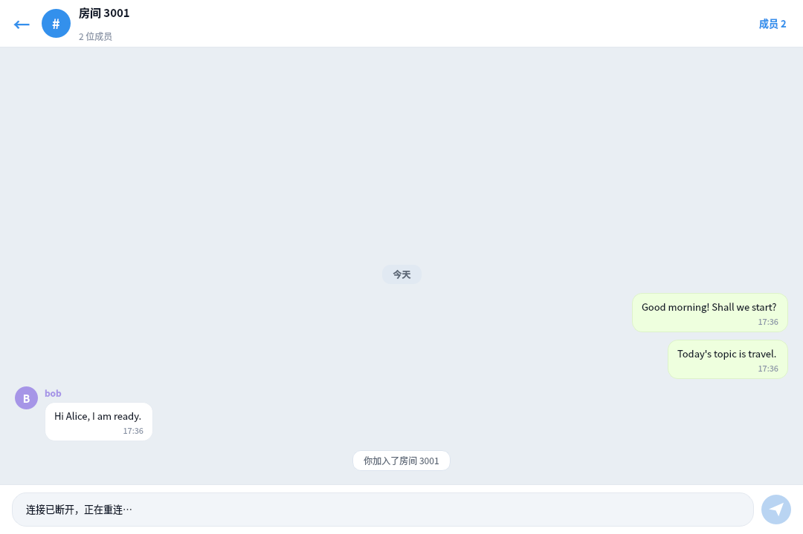 | 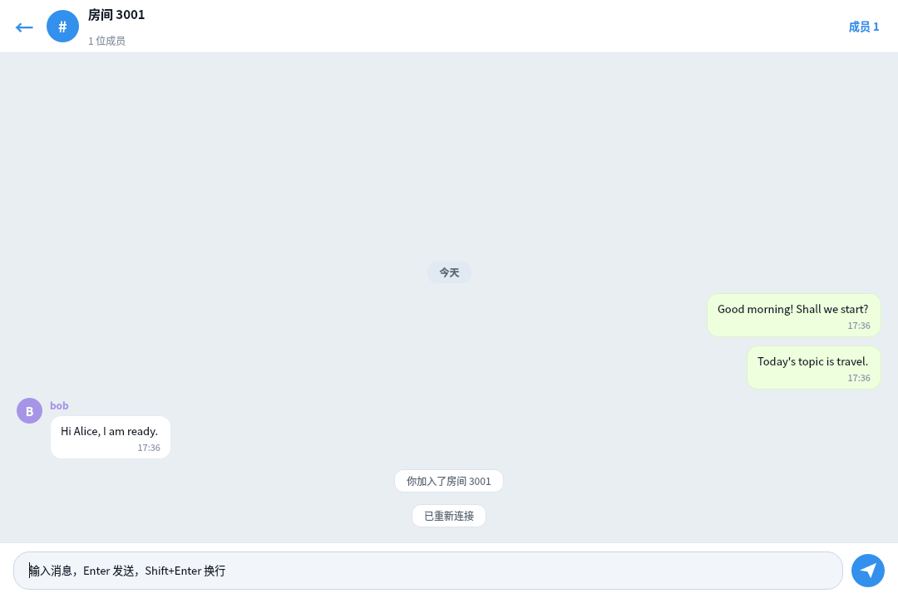 |

| 语音录音中 | 识别结果已插入输入框 |
| --- | --- |
| 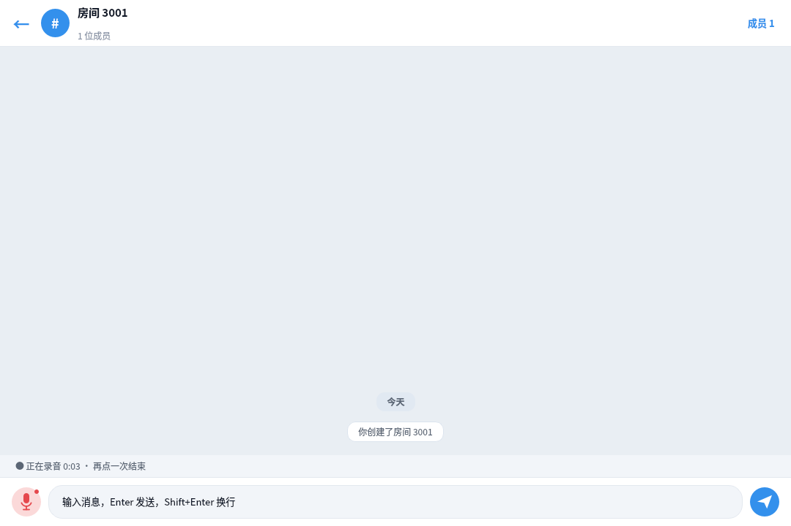 | 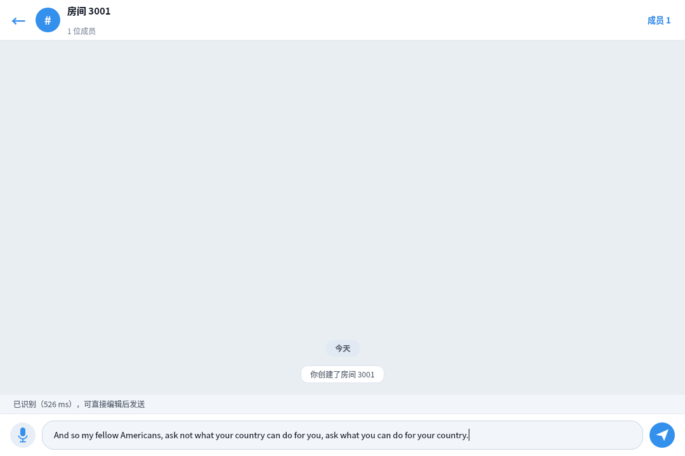 |

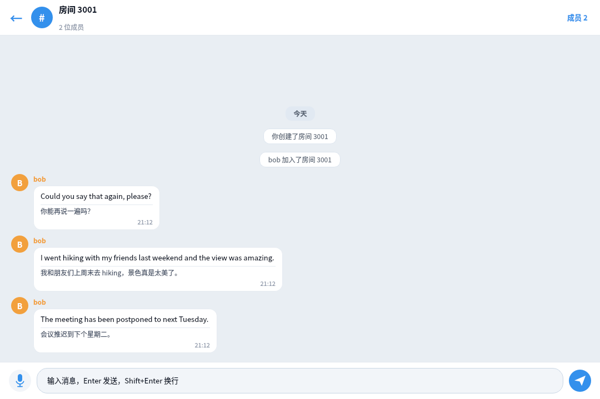

*对方发英文，气泡下方自动出现中文译文。*

---

## 2. 目录结构与分层

代码按职责分五层，依赖方向单向：`ui → business → media/net → core`。
反向依赖一律禁止，`main.cpp` 是唯一的组装点。

```
Dialogue_Pratice_Client/
├── CMakeLists.txt
├── main.cpp                    # 组装 + 命令行 + 元类型注册
│
├── core/                       # 基础设施（不含业务语义）
│   ├── AppConfig.{h,cpp}       # 配置加载 + 热重载
│   ├── Logger.{h,cpp}          # 统一日志（级别 + 模块标签 + 可选落盘）
│   └── Theme.h                 # 调色板 + 全局 QSS
│
├── net/                        # 网络层
│   ├── ChatTransport.h         # 传输抽象（换 WebSocket 只需再写一个实现）
│   ├── ProtocolBridge.{h,cpp}  # QTcpSocket ↔ 协议帧，转成 Qt 信号
│   └── ConnectionManager.{h,cpp} # 连接生命周期 + 断线重连调度
│
├── media/                      # 媒体层（音频采集/编解码/播放/识别/合成）
│   ├── VoiceCodec.{h,cpp}      # Opus 编解码 + DPV1 容器
│   ├── VoiceRecorder.{h,cpp}   # 采集 + 录音状态机（原 VoiceInput）
│   ├── VoicePlayer.{h,cpp}     # 语音消息播放（全局单例）
│   ├── WhisperWorker.{h,cpp}   # 子线程 whisper.cpp 推理
│   └── TtsService.{h,cpp}      # Piper 离线合成 + 播放（单例）
│
├── business/                   # 业务层
│   ├── ChatTypes.h             # 跨层共享的消息/成员结构
│   ├── ChatModel.{h,cpp}       # 消息数据、去重、排序、成员表
│   ├── ChatController.{h,cpp}  # 翻译/建议/语音转写的编排
│   ├── SessionContext.{h,cpp}  # 本人身份 + 房间 + 在线状态（单例）
│   ├── LlmClient.{h,cpp}       # OpenAI 兼容客户端
│   ├── TranslationService.{h,cpp} # 翻译队列、去重、缓存
│   ├── ReplyService.{h,cpp}    # 智能建议回复
│   └── MessageStore.{h,cpp}    # 本地 SQLite 历史缓存
│
├── ui/                         # 界面层
│   ├── MainWindow.{h,cpp}      # 页面调度 + 提示条
│   ├── LoginPage.{h,cpp}       # 服务器地址/端口 + 昵称
│   ├── HomePage.{h,cpp}        # 资料卡 + 房间号输入
│   ├── ProfileDialog.{h,cpp}   # 姓名/年龄/描述
│   ├── ChatPage.{h,cpp}        # 聊天页（纯视图，不含业务编排）
│   └── widgets/                # 可复用控件
│       ├── MessageBubble.{h,cpp}   # 单条气泡
│       ├── VoiceBar.{h,cpp}        # 语音条（波形 + 时长）
│       ├── TranslationCard.{h,cpp} # 译文卡
│       ├── SuggestionBar.{h,cpp}   # 建议条
│       ├── Avatar.{h,cpp}          # 圆形文字头像
│       ├── SendButton.{h,cpp}      # 纸飞机按钮
│       ├── MicButton.{h,cpp}       # 麦克风按钮
│       └── PlayButton.{h,cpp}      # 播放/停止按钮
│
├── config/
│   ├── llm.example.json        # LLM 配置模板（入库）
│   ├── transport.example.json  # 传输配置模板
│   ├── llm.json                # 实际配置（含密钥，gitignore）
│   └── transport.json          # 实际传输配置（gitignore）
├── models/                     # ggml-base.en.bin
├── third_party/whisper.cpp     # 语音识别库（脚本克隆）
├── docs/                       # 方案文档与截图
└── scripts/
    ├── peer_bot.py             # 无界面测试客户端
    ├── setup_voice.sh          # 拉取 whisper.cpp 与模型
    ├── setup_llm.sh / run_llm.sh # 可选：本地 LLM
    └── smoke_test.py（在服务端工程）

```

### 2.1 生命周期与所有权

| 类型 | 策略 | 例子 |
| --- | --- | --- |
| 进程级唯一服务 | **单例** + 函数内静态对象 | `Logger`、`VoicePlayer`、`SessionContext`、`AppConfig` |
| 有明确所有者的对象 | **`std::unique_ptr` 独占** | `ChatModel` / `ChatController`（由 ChatPage 持有） |
| Qt 控件 | **Qt 父子树** | 所有 `QWidget` 派生类 |

**不使用 `shared_ptr`**：Qt 对象已有父子树管理生命周期，再叠一层引用计数容易出现
「父对象析构时子对象仍被 shared_ptr 持有」或反向的双删。跨层只传裸指针或引用，
所有权始终清晰。

### 2.2 ChatPage 的拆分

原本 1199 行的 `ChatPage` 承担了界面、数据、翻译编排三件事，现拆为：

| 类 | 层 | 职责 |
| --- | --- | --- |
| `business::ChatModel` | business | 消息列表、seq 去重、时间排序、成员表 |
| `business::ChatController` | business | 决定翻译谁、何时请求建议、语音转写队列、录音编码发送 |
| `ui::ChatPage` | ui | 只做控件与渲染，监听前两者的信号 |

好处：编排逻辑可以脱离界面单独测试；改界面不会碰到翻译触发条件。

---

## 3. 构建与运行

### 3.1 系统依赖（只需一次）

```bash
sudo apt install -y build-essential cmake \
    qt6-base-dev qt6-multimedia-dev \
    libgl1-mesa-dev libopengl-dev libglx-dev \
    libopus-dev
```

- `libgl1-mesa-dev` / `libopengl-dev`：Qt6Gui 的 WrapOpenGL 必需，缺了 CMake 配置阶段就失败
- `qt6-multimedia-dev`：语音输入（`QAudioSource`）和 TTS 播放（`QMediaPlayer`）
- `libopus-dev`：语音消息编码（20 秒语音压到约 30 KB）
- SQLite 驱动 `libqsqlite.so` 随 Qt6 一起装，不用单独装

### 3.2 第三方组件（只需一次）

```bash
cd ~/Code/Dialogue_Pratice_Client
./scripts/setup_voice.sh    # whisper.cpp + ggml-base.en（约 142 MB）
./scripts/setup_tts.sh      # Piper + en_US-lessac-medium（约 90 MB）
```

三个脚本都是幂等的，已装过会跳过。产物都在 `third_party/` 和 `models/`（已 gitignore）。

### 3.3 编译客户端

```bash
cd ~/Code/Dialogue_Pratice_Client
cmake -S . -B build -DCMAKE_BUILD_TYPE=Release
cmake --build build -j"$(nproc)"
```

产物：

| 文件 | 用途 |
| --- | --- |
| `build/bin/dialogue_client` | 主程序 |

> 客户端默认从 `../Dialogue_Pratice/common` 取协议层。若两个目录不在同一父目录，
> 用 `cmake -DSHARED_ROOT=<path>` 指定。

### 3.4 编译服务端（可选）

只有 `transport=server` 模式才需要：

```bash
cd ~/Code/Dialogue_Pratice
./scripts/build.sh
```

### 3.5 运行

传输方式由 `config/transport.json` 决定，目前只有一种（局域网自研服务端），
所以**必须先把服务端跑起来**：

```bash
# 终端 1：服务端（前台，Ctrl-C 退出）
cd ~/Code/Dialogue_Pratice
./scripts/run.sh

# 想后台常驻：
# setsid ./build/bin/dialogue_server --port 9000 > logs/server.log 2>&1 < /dev/null &

# 终端 2：客户端
cd ~/Code/Dialogue_Pratice_Client
./build/bin/dialogue_client
```

登录页填 `192.168.80.128` / `9000`（本机也可以 `127.0.0.1`），昵称随意。

### 3.6 运行前必须确认的两份配置

| 文件 | 关键字段 | 不填会怎样 |
| --- | --- | --- |
| `config/llm.json` | `apiKey`、`baseUrl`、`model` | 翻译 / 译文卡 / 智能建议**整体停用**，不报错、不出译文行 |
| `config/transport.json` | `transport` | 目前只有 `server` 一个值，一般不用改 |

`llm.json` 改完保存即生效（热重载）；`transport.json` 只在启动时读一次。

### 3.7 两个人对话怎么测

开两个客户端窗口，昵称不同即可——服务端按连接区分会话：

```bash
cd ~/Code/Dialogue_Pratice_Client
./build/bin/dialogue_client &
./build/bin/dialogue_client &
```

两个窗口都填 `192.168.80.128` / `9000`，**昵称不同**、**房间号相同**。

不想开 GUI 的话用无界面机器人发消息：

```bash
python3 scripts/peer_bot.py --name bob --room 1001 --listen 20
```

### 3.8 不开界面的诊断命令

```bash
# 语音识别链路（不需要麦克风）
QT_QPA_PLATFORM=offscreen ./build/bin/dialogue_client \
    --voice-file third_party/whisper.cpp/samples/jfk.wav

# TTS 链路
QT_QPA_PLATFORM=offscreen ./build/bin/dialogue_client --say "Could you say that again?"

# 语音消息：WAV -> 协议 Base64 / Opus 编解码自检
./build/bin/voice_make third_party/whisper.cpp/samples/jfk.wav > /tmp/voice.b64
./build/bin/voice_codec_test third_party/whisper.cpp/samples/jfk.wav

# 服务端协议自检（21 项，需服务端在跑）
cd ~/Code/Dialogue_Pratice && python3 scripts/smoke_test.py
```

---

## 4. 界面与交互

### 4.1 登录页

- 服务器地址 + 端口 + 昵称，回车即登录。
- 地址、端口、昵称记入 `QSettings`（`~/.config/DialoguePratice/Client.conf`），下次自动回填。
- 登录失败（重名以外的原因）在卡片内红字提示，不弹窗。

### 4.2 主页

- 头像、姓名、账号 ID（服务端分配）、姓名 / 年龄 / 个人描述三行资料。
- **编辑个人信息** → 弹窗改姓名、年龄、描述 → 保存后走 `UpdateProfile`（0x07）上行，
  服务端回 `ProfileResp`（0x88）后界面刷新；若改了名字且正在房间里，同房间成员会收到 `rename` 系统消息。
- **房间号 + 进入房间**：服务端收到 `JoinRoom` 后先查房间是否存在——存在则加入，不存在则按该房间号创建。
  客户端据 `RoomState.created` 字段提示「已加入房间」还是「房间不存在，已自动创建」。

### 4.3 聊天页

- 顶栏：返回（离开房间）、房间头像、`房间 <号>`、在线人数、成员侧栏开关。
- 消息区：自己发的靠右（绿色气泡），别人靠左（白色气泡 + 头像 + 昵称），
  带日期分隔（今天/昨天/日期）与系统提示（进房、离房、改名）。
- 输入区：`Enter` 发送、`Shift+Enter` 换行，右侧纸飞机按钮。
- 消息贴底排列（Telegram 行为），新消息自动滚到底部。

### 4.4 历史消息

- 进房时服务端先回 `RoomState`，再回 `HistoryResp`（最近 100 条 / 40 KB 以内）。
- 客户端按 `seq` 去重后合并，重新渲染整个消息区——日期分隔、系统提示的顺序都能保持一致。
- 服务端每个房间保留最近 200 条 / 64 KB；**房间成员走空后仍滞留 5 分钟**（`--room-ttl`），
  期间历史不丢，重新进房还能看到上下文；超时才回收。
- 历史是内存态：**服务端进程重启即清空**（见「已知限制」）。

### 4.5 断线自动重连

- 任何非主动断开（RST、超时、拔网线）都会进入重连流程：每 3 秒重试一次，最多 6 次。
- 重连期间输入框禁用并提示「连接已断开，正在重连…」，顶部横幅显示第几次重试。
- 重连成功后**自动用原身份重新登录并回到原房间**，不需要用户重新操作；
  断线期间别人发的消息由 `HistoryResp` 补齐，本地已有的消息按 `seq` 去重，不会重复。
- 6 次仍失败才退回登录页并给出原因。

---

### 4.6 语音消息（录音发送原始音频）

输入框左侧的麦克风按钮：**点一下开始录音，再点一下把这段原始音频发出去**——
不是把识别出的文字发出去。对方收到的是语音条，可以反复点播。

| 环节 | 做法 |
| --- | --- |
| 采集 | `QAudioSource` 16 kHz / 单声道 / 16-bit（whisper 与 Opus 都吃这个格式，免重采样） |
| 编码 | **Opus 12 kbps**（`VoiceCodec`），11 秒音频 352 KB → **17 KB** |
| 容器 | 自定义 `DPV1`：`"DPV1" + 时长(4B) + [包长(2B) + Opus 包]*N` |
| 传输 | `Voice` 0x09 上行 → 服务端 `VoicePush` 0x8A 广播（含发送者回显） |
| 时长上限 | **20 秒**（超了会提示；单帧 64 KiB 的硬约束） |
| 播放 | 解码成 PCM → 套 WAV 头 → `QSoundEffect`；同一时刻只播一条 |

**收到的语音会自动转写并翻译**（否则听不懂就没法学）：

```
[ ▶ ▁▃▅▇▅▃▁ 0:11 ]            ← 语音条，点击播放
And so my fellow Americans, ...   ← whisper 本地转写（英文原文）
因此，我的美国同胞们，……          ← LLM 翻译（中文）
```

转写走本地 whisper（后台线程，约 0.5–1 秒），转写结果再送翻译服务。
进房补历史时**只转写最近 3 条语音**，避免一次跑太多。

**为什么不用 WAV 直接传**：20 秒 PCM 是 640 KB，Base64 后 850 KB，
远超单帧 64 KiB 上限；Opus 压到 30 KB 后 Base64 只有 40 KB，一帧装得下，
服务端只当不透明字节流搬运，不需要分片重组。

**历史消息里的语音**：服务端把语音条目**单独成帧**发送（一条语音就 30–40 KB，
多条塞一帧会撞上 64 KiB 上限），客户端本来就在增量合并历史，多个 `HistoryResp`
按 `seq` 合并即可。

**没有麦克风时怎么验证**（虚拟机常见情况）：

```bash
# 1) 把一段 16k 单声道 WAV 编成协议用的 Base64
./build/bin/voice_make third_party/whisper.cpp/samples/jfk.wav > /tmp/voice.b64

# 2) 让模拟对端把这条语音发出去
python3 scripts/peer_bot.py --name bob --room 3003 --voice-b64 /tmp/voice.b64 --listen 5

# 3) 客户端里就能看到语音条 + 英文转写 + 中文译文
```

还有两个独立的诊断命令：

```bash
# Opus 编解码自检（压缩比 + 时长 + 能量）
./build/bin/voice_codec_test third_party/whisper.cpp/samples/jfk.wav

# 纯「WAV → 文本」的识别链路（不涉及网络）
QT_QPA_PLATFORM=offscreen ./build/bin/dialogue_client \
    --voice-file third_party/whisper.cpp/samples/jfk.wav
```

> **已知限制**：虚拟机里如果没把宿主麦克风直通进来，录音只能录到静音。
> 此时点麦克风会提示「录音太短，没有说话」——这是保护，不是 bug。

### 4.7 翻译（云端 LLM）

他人发来的**纯英文**消息，会在气泡下方自动补一行中文译文（灰色、字号小 1pt、带分隔线）。

- 只翻「他人 + 纯英文」：自己的消息不翻，含汉字的混合消息不翻
- **串行队列**：保证译文顺序，也避免同时打满云端限流
- **缓存 + 去重**：同一句话只请求一次；同一条在队列里不会重复入队
- 进房补历史时**只翻最近 12 条**，避免一次排队几十个请求拖慢首屏
- LLM 不可用时显示红色「翻译失败」，**聊天不受影响**，不阻塞任何交互
- 之前没配 Key 而没翻的消息，**填好 Key 保存后会自动补翻**

### 4.7.1 配置文件

所有 LLM 参数都在 `config/llm.json`，**改完保存即生效**（`QFileSystemWatcher` 热重载），
不用重新编译或重启客户端：

```json
{
  "llm": {
    "enabled": true,
    "baseUrl": "https://api.deepseek.com",
    "apiKey": "sk-...",
    "model": "deepseek-chat",
    "temperature": 0.2,
    "timeoutMs": 40000
  },
  "translation": {
    "maxHistoryMessages": 12,
    "cacheSize": 500,
    "llm": {}
  }
}
```

| 字段 | 说明 |
| --- | --- |
| `baseUrl` | OpenAI 兼容地址。写域名、写 `…/v1`、写完整 endpoint 都能识别 |
| `apiKey` | 云端必填；本地/局域网地址（`127.0.0.1`、`192.168.x.x`、`10.x`、`172.16-31.x`）可留空 |
| `model` | 例如 `deepseek-chat`、`qwen-plus`、`gpt-4o-mini` |
| `temperature` | 翻译建议 0.1–0.3 |
| `reasoningEffort` | 推理模型专用（`low`/`medium`/`high`）。翻译用 `low` 能省一半时间，留空则不传 |
| `maxHistoryMessages` | 进房时最多补翻多少条历史 |
| `cacheSize` | 译文缓存条数 |

查找顺序：`--config <path>` → 环境变量 `DP_LLM_CONFIG` → `config/llm.json` → `~/.config/DialoguePratice/llm.json`。
文件不存在时会自动生成一份带注释的模板。

### 4.7.1.0 服务端统一下发（推荐）

**客户端可以完全没有 `config/llm.json`**。服务端在 `LoginResp` 里下发一份完整配置，
客户端收到后覆盖本地设置，并停止监听本地文件变化（避免两者互相覆盖）。

优先级：**服务端下发 > 本地文件 > 内置默认值**

| 情况 | 客户端行为 |
| --- | --- |
| 服务端有配置 | 用服务端的，本地文件被忽略 |
| 服务端没配（`llmConfigPath` 为空或文件缺失） | 回退读本地文件 |
| 两者都没有 | 翻译/建议静默不可用，不弹错误提示 |

服务端侧只需维护一份 `config/llm.json`（格式与客户端完全一致，直接复用同一套解析逻辑）：

```json
{
  "llm":        { "baseUrl": "...", "apiKey": "sk-...", "model": "..." },
  "translation": { "llm": { "baseUrl": "...", "model": "..." } }
}
```

**改完需要重启服务端**（客户端侧是热重载，服务端暂未做）。

好处：新机器装上就能用，不用逐台填 key；换模型只改一处。代价是 key 会下发到客户端内存——
内网教学场景可接受，公网推广需要改成服务端代理（见 4.7.1.2）。

> `config/llm.json` 含密钥，已加入 `.gitignore`；入库的是 `llm.example.json`。

### 4.7.1.1 翻译和对话分开用不同模型

翻译要**准**，智能建议要**自然**——这两件事其实该用不同的模型。
所以 `translation.llm` 支持单独配置：

```json
{
  "llm": {
    "baseUrl": "https://api.deepseek.com",
    "apiKey": "sk-...",
    "model": "deepseek-chat"
  },
  "translation": {
    "llm": {
      "baseUrl": "http://192.168.80.1:8080",
      "model": "hunyuan-mt-7b",
      "temperature": 0.1
    }
  }
}
```

这样：**翻译走 Hunyuan-MT（WMT 冠军），对话和智能建议走 Qwen/DeepSeek**。

规则：

| 情况 | 行为 |
| --- | --- |
| `translation.llm` 是 `{}` 或不存在 | 翻译沿用主模型（旧配置完全兼容） |
| 配了 `baseUrl`，没配 `apiKey` | 地址相同则继承主模型的 Key；地址不同则视为缺 Key |
| 地址不同且没有 Key | **回退到主模型**，并提示「翻译专用模型缺少 apiKey，已回退到主模型」 |
| 地址是本地/局域网 | 不要求 Key（自建 llama-server 场景） |

> 为什么 Key 不无条件继承：翻译模型常常在另一家服务商（比如主模型用 DeepSeek、
> 翻译用硅基流动的 Hunyuan-MT），把 A 家的 Key 发给 B 家只会得到一堆 401。

实现上是两个独立的 `LlmClient` 实例：`TranslationService` 用 `translateLlm_`，
`ReplyService` 用 `llm_`，互不干扰。上面截图就是双模型运行效果——
译文来自 18082 的翻译模型，三条建议来自 18081 的对话模型。

### 4.7.2 常用服务商

| 服务商 | `baseUrl` | `model` |
| --- | --- | --- |
| DeepSeek | `https://api.deepseek.com` | `deepseek-chat` |
| 通义千问 | `https://dashscope.aliyuncs.com/compatible-mode/v1` | `qwen-plus` |
| Moonshot | `https://api.moonshot.cn/v1` | `moonshot-v1-8k` |
| OpenAI | `https://api.openai.com/v1` | `gpt-4o-mini` |
| 讯飞星火（MaaS） | `https://maas-api.cn-huabei-1.xf-yun.com/v2/chat/completions` | `spark-x2.6` |
| 聚合代理（如 sharesai） | `https://api.sharesai.xyz/v1` | 见服务商文档，如 `gpt-6.1-sol` |

#### ⚠️ 推理模型必须关掉思考

`spark-x2.6`、`gpt-6.1-sol` 这类**推理模型**会先输出 `reasoning_content` 再给正文。
如果不关掉，token 全花在思考上，`content` 会是空的——实测 `spark-x2.6` 默认参数下
**400 token 打满、17 秒、正文为空**，界面上表现为「翻译失败」。

必须设 `reasoningEffort`：

| 设置 | 一句翻译的实测耗时 | 说明 |
| --- | --- | --- |
| 不设（默认） | 17 s，**正文为空** | 不可用 |
| `"low"` | 4.5 s | 有思考，能用 |
| **`"none"`** | **2.3 s** | **推荐**，直接出译文 |

```json
{
  "llm": {
    "baseUrl": "https://maas-api.cn-huabei-1.xf-yun.com/v2/chat/completions",
    "apiKey": "ak-...",
    "model": "spark-x2.6",
    "reasoningEffort": "none",
    "timeoutMs": 40000
  }
}
```

> 星火还认 `enable_thinking: false`、`thinking: {type: disabled}`、`chat_template_kwargs: {enable_thinking: false}`
> 这几种写法（实测都能关掉思考），但 `reasoningEffort` 是我们配置里已有的字段，最省事。
>
> 如果忘设，`LlmClient` 会识别出「正文空但 reasoning 非空」，提示
> **「模型只输出了思考过程，没有正文（把 reasoningEffort 设为 none）」**，而不是含糊的「空内容」。

> `baseUrl` 填**完整 endpoint**（以 `/chat/completions` 结尾）最保险；填到 `/v1` 或 `/v2`
> 也能自动补全，但别填到域名根——那会按 OpenAI 习惯补成 `/v1/chat/completions`。

### 4.8 传输层

界面只依赖 `ChatTransport` 抽象，目前只有一种实现：

| 实现 | 说明 |
| --- | --- |
| `ProtocolBridge` | 自研 TCP 服务端，**局域网可用**，服务端自己存历史 |

`config/transport.json` 只有一个字段，一般不用动：

```json
{ "transport": "server" }
```

> 早期版本支持声网 RTM（公网可达、无需自建服务端），已于 2026-10-29 完全移除：
> `RtmBridge`、SDK（13 MB）、`rtm_smoke` 自检程序、`setup_agora.sh` 一并清理，
> 二进制也不再链接 `libagora_rtm_sdk.so`。设计过程保留在 `docs/plan-agora-rtm.md` 里作记录。
>
> `ChatTransport` 抽象层保留着——以后要接 WebSocket、MQTT 之类，只需再写一个实现，
> 界面代码一行不用改。

### 4.8.1 本地消息缓存

服务端的历史是内存态（进程重启即清空），所以客户端自己再存一份 SQLite 兜底：

| 项 | 说明 |
| --- | --- |
| 位置 | `~/.local/share/DialoguePratice/Client/history.db` |
| 表 | `messages(source, room, seq, from_id, name, text, ts)`，主键 `(source, room, seq)` |
| 去重 | `INSERT OR REPLACE`；`source` 现在固定是 `server`（字段保留，兼容历史数据） |
| 读取 | 进房时取该房间最近 200 条，与服务端给的历史按 `seq` 合并 |
| 上限 | 每房间保留最近 500 条，进房时自动裁剪 |
| 并发 | `journal_mode=WAL` + `busy_timeout=3000`，支持同机多开 |

### 4.9 语音合成（TTS）

他人发来的英文气泡左下角有 **▶ 播放** 按钮，点一下用 Piper 合成并朗读；再点可重播。

- **完全离线**：Piper 神经网络 TTS，`en_US-lessac-medium` 音色，单句约 100–300 ms
- **按文本缓存**：同一句只合成一次，WAV 存在 `~/.cache/DialoguePratice/Client/tts/`
- 语速用 `--length-scale 1.05` 略放慢，方便跟读
- 播放中按钮变成暂停图标（气泡和译文卡两处都会同步）
- 播放用 **`QSoundEffect`**，不用 `QMediaPlayer`——原因见第 6 节第 11 条

缓存写入是**原子**的：piper 先写 `xxx.wav.part`，成功后才改名成 `xxx.wav`。
否则合成中途被打断会留下半个 WAV，下次被当成缓存命中，播出来只有半秒（听起来就是"没声音"）。

诊断（不用开界面）：

```bash
QT_QPA_PLATFORM=offscreen ./build/bin/dialogue_client --say "Could you say that again?"

# 反复播放测试：rapid = 每 800ms 点一次共 6 次（模拟快速连点）
./build/bin/tts_repeat normal
./build/bin/tts_repeat rapid
```

### 4.10 中文输入译文卡

在输入框里打中文，**停顿 500 ms** 后上方弹出译文卡：

```
┌─ 译文 ───────────────────────────────┐
│ Could you repeat that?                │
│                        ▶   填入输入框  │
└──────────────────────────────────────┘
[ 🎤 ]  [ 你能再说一遍吗          ]  [ ➤ ]
```

- **▶ 播放**：听这句英文怎么说（TTS），可反复听
- **填入输入框**：把英文放进输入框，改完回车发送
- 输入框清空 → 卡片自动消失
- 翻译没配 Key 或失败时不弹卡片，不影响打字

这条链路就是「输入中文 → 看英文 → 听发音 → 跟读说出来」的闭环前半段；
后半段用麦克风说英文，whisper 转文字后发送。

### 4.11 智能提示回复

输入框为空、且收到他人消息时，自动生成 **3 条英文建议**（800 ms 防抖，取最近 6 条对话作上下文），
**每条英文下方跟一行中文译文**（灰色小字）。

- 点 chip 正文 → 填入输入框，可直接发或先改
- 点 chip 右侧 **▶** → 听这句怎么说
- 一开始打字就自动收起，不抢输入框位置
- 与译文卡**互斥**：输入框有中文 → 显示译文卡；输入框为空 → 显示建议

**中英由同一次请求产出**，不是先出英文再逐条调翻译——这样语义严格对齐，
也省掉 3 次额外请求的延迟（实测一次请求约 7 秒，输出 254 tokens）：

```json
[
  {"en": "I'd love to! Let me know when you go again.", "zh": "好呀！下次去的时候叫上我。"},
  {"en": "Sounds fun! Is the trail okay for beginners?", "zh": "听着挺有意思！那条路适合新手吗？"}
]
```

解析顺序：对象数组 `{en, zh}` → 字符串数组（兼容旧格式，只有英文）→ 按行拆分
（去掉 `1.` `-` 这类前缀）。最多取 3 条、英文超过 120 字符的丢弃。

chip 用 `QFrame` 自己实现（英文 `QLabel` + 中文 `QLabel` + `mousePressEvent`），
因为 `QPushButton` 只能渲染单一样式的单行文本。

---

## 5. 与服务端协议的对接

协议定义在 `../Dialogue_Pratice/common/Protocol.h`，客户端只做两件事：
`dp::encodeFrame()` 组帧发送，`dp::FrameDecoder` 增量解帧。

| 客户端动作 | 上行 | 服务端回应 |
| --- | --- | --- |
| 登录 | `Login` 0x01 `{name, age, desc}` | `LoginResp` 0x81 + `SystemMsg(welcome)` |
| 编辑资料 | `UpdateProfile` 0x07 `{name, age, desc}` | `ProfileResp` 0x88；改名时房内广播 `SystemMsg(rename)` |
| 进房 | `JoinRoom` 0x02 `{room}` | `RoomState` 0x82 `{room, created, members[]}` → `HistoryResp` 0x89 `{room, messages[]}` |
| 发言 | `Chat` 0x04 `{text}` | `ChatPush` 0x83 `{seq, from, name, room, text, ts}`（含自己，回显） |
| 离开 | `LeaveRoom` 0x03 | `SystemMsg(left)` + 房内 `SystemMsg(leave)` |
| 心跳 | `Ping` 0x06（每 30s） | `Pong` 0x86 |

`QTcpSocket` 只保证字节流顺序，粘包/半包由共享的 `FrameDecoder` 处理——与服务端同一份代码，
不会出现「两边解析不一致」的协议漂移。

---

## 5.5 响应式布局与移动端适配

桌面版是 1080×720 的三栏布局，手机竖屏只有 360–420 dp 宽。这里不维护两套界面，
而是把尺寸集中到 `core/UiMetrics.h`，各页面在 `resizeEvent` 里按**运行时宽度**取值。

| 阈值 | 值 | 说明 |
| --- | --- | --- |
| 紧凑模式断点 | 600 px | 低于此宽度按移动端布局处理 |
| 触摸目标 | 44 px | 按钮最小边长 |
| 卡片上限 | 420 px | 桌面观感上限，窄屏压到可用宽度 |
| 气泡上限 | 520 px 或 78% 宽 | 取小值 |

### 具体适配点

| 位置 | 桌面 | 窄屏（< 600） |
| --- | --- | --- |
| 窗口最小尺寸 | 940×620 | **360×480**（手机上 940 根本达不到） |
| 登录/主页卡片 | 固定 420 / 560 | 按可用宽度收缩，两侧留 24 |
| 成员列表 | 右侧 220px 侧栏 | **模态弹窗**（没有横向空间放侧栏） |
| 消息气泡 | 固定 520 | 按消息区宽度 78% 收缩 |
| 输入框提示 | "输入消息，Enter 发送…" | "输入消息…"（长文案会折行被裁切） |
| 返回按钮 | 34×34 | **44×44**（触摸目标） |
| 资料对话框 | 固定 440 | 按父窗口宽度收敛 |

### 为什么用运行时宽度而不是编译期平台宏

`#ifdef Q_OS_ANDROID` 只能在 Android 上验证，改一行要重新打包才能看到效果。
用运行时宽度判断，在桌面把窗口拖到 360 宽就能立刻验证移动端布局——
在 Android 工具链就绪之前，这是唯一的验证手段。

### Android 打包的前置条件（当前未安装）

| 组件 | 用途 | 体积 |
| --- | --- | --- |
| **Qt 6.2.x for Android** | apt 装的 Qt6 **不含** Android 支持 | ~2–3 GB |
| Android SDK | 平台工具、构建工具 | ~1.5 GB |
| Android NDK (r23+) | 交叉编译 C++ | ~1 GB |
| JDK 11 / 17 | Gradle 构建 APK | ~300 MB |

Qt for Android 必须用 **Qt 在线安装器**单独装（要登录 Qt 账号，图形界面操作），
apt 源里没有。装好后：

```bash
# 用 Qt 的 Android kit 配置
~/Qt/6.2.4/android_arm64_v8a/bin/qt-cmake \
    -S . -B build-android \
    -DANDROID_ABI=arm64-v8a \
    -DANDROID_SDK_ROOT=$HOME/Android/Sdk \
    -DANDROID_NDK_ROOT=$HOME/Android/Sdk/ndk/23.2.8568313

cmake --build build-android --target apk
```

> **注意**：whisper.cpp 与 Piper 都是 x86_64 的本地依赖，交叉编译到 arm64 需要
> 先为 Android ABI 重新构建这两个库。这一步的复杂度可能超过 UI 适配本身。
> 如果移动端只需要「文字聊天 + 翻译」，可以考虑在移动端关闭语音功能
> （编译期开关），把语音留给桌面端。

---

## 6. 实现中踩过的坑

1. **QLabel 开了 `wordWrap` 后尺寸算不准。** 直接丢进布局会被压窄，短句被提前折行
   （「bob 加入了房间 / 1001」）。解决：先用 `QFontMetrics::boundingRect()` 按上限宽度量出
   实际需要多宽，再 `setFixedWidth()`；`ensurePolished()` 必须先调用，否则量到的是 QSS 生效前的字体。
2. **消息贴底**靠的是「布局首项放弹簧」，新消息 `addWidget` 追加在弹簧之后；
   若把弹簧放末尾，消息会全部挤在顶部。
3. **`QPlainTextEdit` 默认吃掉 Tab**（插入制表符），弹窗里 Tab 无法切到下一个控件。
   个人描述框设 `setTabChangesFocus(true)`。
4. **模态弹窗在无合成器的 X 下截图是黑的**——它是独立顶层窗口，`import -window <主窗口>` 抓不到内容，
   要单独抓弹窗自己的 window id。
5. **服务端改了协议必须重启进程**：客户端发 0x07 时旧服务端回
   `unsupported opcode: Unknown`，这个报错其实是版本不一致的可靠信号。
6. **RST 断线时 `errorOccurred` 先于 `disconnected` 到达**。只在 `disconnected` 里启动重连的话，
   错误分支会先把用户踢回登录页——必须在错误分支里判断「已登录 → 走重连」。
7. **重连后服务端会分配新 userId**，历史里自己旧 id 的消息会被渲染成别人发的。
   客户端用 `selfIds_` 记录本次运行的所有身份；跨进程重启则靠「同名 + 已不在房间」推断。
8. **滚动贴底不能只 `setValue(max)` 一次**：气泡换行/批量插入会让内容高度异步变化，
   需要监听 `rangeChanged`，在「仍处于贴底状态」时继续贴底。
9. **信号不能和同名 getter 共存**：`modelReady()` 取值函数与 `modelReady(bool)` 信号重名后，
   `&VoiceInput::modelReady` 无法取地址，`connect` 直接编译失败。信号改名为 `modelLoaded`。
10. **Qt Multimedia 在 Linux 走 PulseAudio 的 ALSA 兼容层**，改 PulseAudio 默认输入源对已启动的
    Qt 进程不生效；验证时得用 `pactl move-source-output` 把录音流改接到虚拟麦克风。
11. **`QMediaPlayer` 在播放中途 `stop()` 后立刻 `setSource` 同一文件再 `play()`，会进入
    PlayingState 但完全不出声**。实测：连续点 6 次，只有第 1 次有声音，后面 5 次
    `playbackStateChanged` 都报 Playing、`positionChanged` 也照常推进，就是没有音频输出。
    换成 `QSoundEffect`（专为短音效设计，`stop()` + `play()` 可反复重播）后恢复正常。
    这个坑只有「录音 + 分析波形」才能确认——单看状态日志会误判成播放正常。
12. **缓存文件必须原子写入**：piper 中途被 kill 会留下半个 WAV（头声明的长度大于实际数据），
    下次 `QFileInfo::exists()` 命中，播出来只有 0.5 秒，听起来就是「点了没声音」。
    现在先写 `.part`，成功才 `rename`；读缓存时还额外校验 `size() > 44`（WAV 头长度）。

---

## 7. 已知限制

- 无鉴权、无 TLS：协议是明文 JSON，仅适合内网/教学环境。
- **历史消息是内存态**：服务端进程重启即清空，且只保留每个房间最近 200 条 / 64 KB。
  要持久化需要在服务端落库（SQLite/文件），属于下一阶段工作。
- 断线重连最多 6 次（间隔 3 秒）；仍失败则退回登录页，不保留未发送的草稿。
- 重连后 `userId` 会变（服务端不做会话恢复），历史归属靠 id 集合 + 同名推断，
  同名用户并存时可能误判。
- **语音输入依赖本地麦克风**：虚拟机里需把宿主麦克风直通进来，且 ALSA 的 `Capture` 增益不能为 0。
- 语音模型固定英文（`base.en`，142 MB），识别在 CPU 上跑；中文需换多语言模型并改 `language`。
- **翻译需要联网 + 有效 Key**：断网或 Key 失效时译文行显示「翻译失败」，聊天本身不受影响。
- 消息正文会发送到配置的 LLM 服务商（云端），敏感内容请注意。
- 无「正在输入」、已读回执、图片/文件发送。
